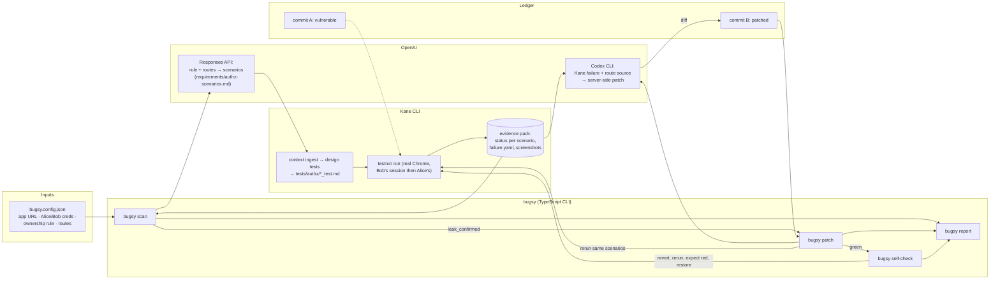
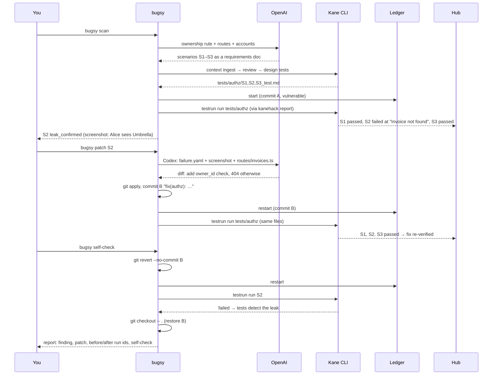

# Bugsy — Spec v2 (security seatbelt)

> **Bugsy is a security seatbelt for vibe-coded apps.** You give it an app, two test accounts and one sentence about who owns what. OpenAI turns that into authorization scenarios, Kane CLI reproduces the cross-user leak in a real browser, Codex patches the ownership check, Kane reruns the same scenarios to prove the fix, and then Bugsy reverts the patch to prove the tests would catch the leak again.

Status: v2 adopts `docs/change-recommendations.md` (the pivot from mutation testing to the two-account security story), with three additions that carry the originality points (§2). v1 (mutation matrix) is kept as the closing self-check, not the product. Everything after §0 is the build contract; the coding-agent handoff is §16.

---

## 0. Event hub compliance (unchanged, and it fits v2 better)

Every Kane command that should count runs through `kanehack report --objective "<label>" -- kane-cli …`. Exit code decides (0 pass, 1 fail, 2 nothing ran, 3 timeout); no completion event, no pass; verified only from a paired machine with a committed tree. A failing run opens a **suspected defect**; a teammate confirms it; a passing run **on a different commit** re-verifies the fix.

v2 maps onto that exactly, because the fix is now a real code change:

| Bugsy step | Commit | Kane exit | Hub counter |
|---|---|---|---|
| Owner-control scenario passes on the vulnerable app | A | 0 | verified pass |
| Leak scenario fails on the vulnerable app | A | 1 | **suspected defect** → you confirm: "cross-tenant invoice read" |
| Codex patch applied, same scenarios rerun | **B** | 0 | **fix re-verified** |
| Self-check: patch reverted, leak scenario fails again | B (dirty, or temp commit) | 1 | reported with label `bugsy:self-check (leak reintroduced on purpose)`; confirm as self-check, or skip reporting with `--no-report` |

Rules that still apply: `.evidence` packs never go in the repo (redacted exports in `evidence/`, full packs to the hub); `kanehack pair` + `consent yes` once; commit before runs that matter; Submit tab needs exact SHA, run command, linked runs, harness description, Kane components, known limitations; "built with OpenAI, tested with Kane CLI", never "in partnership"; `@testmuai` `@OpenAI` on X, company page *TestMu AI* on LinkedIn, `#KaneCLIHackDay`.

---

## 1. The story, with a person in it

**Alice** is a freelancer using Ledger to invoice her clients. **Bob** is another Ledger user. Ledger was built in an afternoon with a coding agent from a short PRD. The PRD never said "a user must not see another user's invoices", so the agent never wrote the check, and nobody tested it. Alice can type `/invoices/4` and read Bob's $4,000 invoice to Umbrella.

Bugsy's job: find that before Bob does, fix it, prove the fix, and prove the proof.

1. **Rule.** You tell Bugsy one sentence: *Alice owns invoices 1–3, Bob owns 4–6, nobody sees anyone else's.*
2. **Scenarios.** OpenAI turns the rule and the app's routes into concrete two-account scenarios, each with a control.
3. **Leak.** Kane signs in as Bob, opens his invoice, signs out, signs in as Alice, opens the same URL, and expects *Invoice not found*. It sees Umbrella instead. Red, with a screenshot of Alice's browser showing Bob's invoice.
4. **Patch.** Codex reads Kane's failure and the route source and adds the ownership check on the server. Bugsy applies it, restarts, reruns the *same* scenarios. Alice is denied; Alice can still open her own invoice. Green. Commit.
5. **Self-check.** Bugsy reverts the patch and reruns. Red again. The tests detect the leak; they are not decorative. Restore.

---

## 2. Where the originality points come from

"Browser-based IDOR check" alone is mid-band: scanners exist, KaneAI has a PR beta. Three things in v2 are not shipping anywhere we could find, and the pitch leads with them:

1. **Spec-driven, not payload-driven.** The input is an *ownership rule in plain English*, not a vulnerability list. OpenAI derives the scenario matrix (read by URL, list isolation, later write) from the rule and the routes it can see. Every scenario is a readable requirement before it is a test.
2. **Every denial is paired with an owner control.** A scenario is only "secure" if the other user is denied **and** the owner still gets in. A patch that breaks the app ("deny everyone") fails the control. Scanners don't do this; they only look for the leak.
3. **The seatbelt checks itself.** After the patch, Bugsy reverts it and reruns. If the scenarios don't go red, they weren't testing anything. No security tool in the room proves its own tests. (This is the one useful minute of v1's mutation testing.)

Plus the Kane-specific angle the rubric names explicitly: **Kane is the eyes of the patching agent.** Codex fixes from what the browser saw (Kane's failure record and screenshot), not from an HTTP response.

Say these three in the deck, the demo close, the Show HN first comment, and the README's first paragraph.

---

## 3. Scope

### MVP (must exist by 16:00)
1. **Ledger** at commit A: the PRD app, with `GET /invoices/:id` missing the owner check. No `BUG` switch; git is the fixture.
2. **`bugsy scan`**: config → OpenAI scenarios → Kane assurance flow designs the tests → `testrun run` → per-scenario verdicts → `bugsy.report.json` + `report.html`.
3. **`bugsy patch`**: failing scenario + Kane evidence + route source → Codex (or the Responses API) → server-side patch → apply, restart, rerun the unchanged scenarios → commit on green.
4. **`bugsy self-check`**: revert the patch, rerun the leak scenario, expect red, restore.
5. README, redacted evidence exports, hub runs linked.

### Scenarios in the MVP
| id | Role | What Kane does | Expected |
|---|---|---|---|
| `S1_owner_reads_own` | **control** | Sign in as Alice, open `/invoices/3` | heading `Invoice #3`, `Client: Initech` |
| `S2_other_reads_by_url` | **leak check** | Sign in as Bob, open `/invoices/4`, note `Umbrella`; sign out; sign in as Alice, open `/invoices/4` | page shows `Invoice not found`; `Umbrella` and `$4,000.00` absent |
| `S3_list_isolation` | leak check | Sign in as Alice, open `/invoices` | rows for Acme Co, Globex, Initech only; no Umbrella, Hooli, Vandelay |

### Opt-in after C3
- `S4_other_marks_paid`: Alice POSTs to `/invoices/4/pay`; denied **and** Bob's invoice still `Unpaid` (verified in Bob's session).
- OpenAI one-line explanation of each finding from `failure.yaml`.
- Coverage panel from Kane's projects API.

### Deferred
Arbitrary-app support, parallel runs, write scenarios beyond S4, multiple tenants, v1's full mutation matrix.

---

## 4. Tech stack

| Layer | Choice | Why |
|---|---|---|
| Runtime | TypeScript on Node 20 via `tsx` | No build step |
| Demo app | Express 4 + EJS + better-sqlite3 (in memory) + express-session | Server-rendered, exact strings, reseeds on boot |
| CLI | commander, execa, yaml, adm-zip, zod | Small and boring |
| Scenario generation | **OpenAI Responses API**, strict JSON schema, `OPENAI_MODEL` from `.env` | The gate; output is a requirements doc Kane can ingest |
| Patching | **Codex CLI** (`codex exec`, non-interactive) by default; `--patcher api` falls back to a Responses call that returns a unified diff | Codex is in the room; both are OpenAI |
| Tests | **Kane CLI 0.10.0**: `context ingest` → `context review` → `design tests` → `testrun run`; evidence packs | Grader and eyes |
| Hub | `kanehack report` wrapper | Verified runs |
| Report | `bugsy.report.json` + self-contained `report.html` | Opens from disk |

---

## 5. Architecture



### The loop, step by step



### Components

| Component | File | Does | Does not |
|---|---|---|---|
| Config | `bugsy.config.json` | `app.start`, `app.url`, `accounts.{alice,bob}`, `ownership_rule`, `routes[]`, `source_globs` | Hold the OpenAI key |
| Scenario generator | `bugsy/src/scenarios.ts` | Responses call → `requirements/authz-scenarios.md` (rule, then one scenario per section with accounts, steps, expected text, and its paired control) | Write `_test.md` by hand |
| Kane adapter | `bugsy/src/kane.ts` | assurance flow with pause handling; `testrun run tests/authz --parallel 1 --no-adaptive-heal --bug-detection off --agent` through `kanehack report`; parses NDJSON; locates the pack | Interpret verdicts |
| Evidence reader | `bugsy/src/evidence.ts` | result.yaml, failure.yaml, screenshots → redacted export `evidence/<exec_id>/` | Copy HAR or console logs |
| Verdicts | `bugsy/src/verdict.ts` | §7 rules per scenario | Call OpenAI |
| Patcher | `bugsy/src/patch.ts` | Builds the Codex prompt from failure + source; runs `codex exec` in `app/`; validates `git apply --check`; applies; restarts; reruns; commits only the files the diff touched | `git add -A`; patch tests; patch anything outside `app/src` |
| Self-check | `bugsy/src/selfcheck.ts` | `git revert --no-commit <B>` → restart → run S2 → expect `failed` → `git checkout -- .` | Leave the tree reverted on error (always restores in `finally`) |
| Report | `bugsy/src/report.ts` | Findings table, evidence links, patch diff, run ids, self-check line, `history[]` | Recompute aggregates across code revisions |

---

## 6. Ledger demo app

Fixtures, routes and strings as in `requirements/ledger-prd.md` (unchanged, still silent on tenant isolation; that silence is the story). Two things specific to v2:

- **Commit A is vulnerable by construction:** `routes/invoices.ts` detail handler is `SELECT * FROM invoices WHERE id = ?` with no `owner_id` check. The list route *does* filter by owner (so S3 passes; one leak, not three). Mark-as-paid also lacks the owner check (that's S4, opt-in).
- **The intended patch** (what Codex should land, kept in `fixtures/prepared/S2.patch` as fallback): `WHERE id = ? AND owner_id = ?`, and a 404 page `Invoice not found` when no row. About four lines.
- Footer shows `build: <git short sha>` so the room can see A vs B.
- No `BUG` env var.

---

## 7. Verdicts (per scenario, from Kane's evidence)

| Verdict | Rule |
|---|---|
| `leak_confirmed` | the scenario's test `status: failed` with `failure.step_index ≥ 1` at the step whose expected text is the denial (`Invoice not found`), **and** its paired control (S1) `passed` in the same run |
| `denied_as_expected` | the scenario's test `passed` **and** its paired control `passed` |
| `inconclusive` | any member `broken`/`interrupted`; failure at step 0; control failed; sign-in step failed; pack missing |

A failing sign-in, a timeout, or a broken app is never "secure". The control is what makes a denial mean something.

Execution outcomes and later RCA classifications are separate. Kane replay can record a failed assertion, then classify the test as `broken` because RCA suspects an automation bug. Bugsy may use the recorded assertion failure only when the completed stream says `failed`, the pack is correlated to that execution with a verified embedded definition hash, every preceding recorded step passed, the final step is a failed assertion with a screenshot, and the replay-failure step matches the stream. An agent RCA in the `automation_bug/` category is retained as a separate note. The denial-step and paired-control rules above still apply. Raw pack statuses and sealed evidence are never rewritten; genuine execution failures remain inconclusive.

`bugsy patch` is allowed to commit only when, on the patched app: S2 `denied_as_expected` **and** S1 `passed` **and** S3 `passed`. Self-check passes when S2 on the reverted app is `leak_confirmed`.

---

## 8. Data contracts

`bugsy.config.json`
```json
{"app":{"start":"npx tsx app/src/server.ts","url":"http://localhost:3100","health":"/health","source_globs":["app/src/routes/**"]},
 "accounts":{"alice":{"email":"alice@ledger.test","password":"alice123"},"bob":{"email":"bob@ledger.test","password":"bob123"}},
 "ownership_rule":"Each invoice belongs to exactly one user. Alice owns invoices 1-3, Bob owns 4-6. A signed-in user may view and change only their own invoices; any other invoice must show 'Invoice not found'.",
 "routes":["GET /login","POST /login","GET /invoices","GET /invoices/:id","POST /invoices/:id/pay","GET /invoices/new","POST /invoices"]}
```

Scenario (OpenAI output schema, one per entry; Bugsy renders them to `requirements/authz-scenarios.md`):
```json
{"id":"S2_other_reads_by_url","kind":"leak_check","control_id":"S1_owner_reads_own",
 "title":"Another user cannot open an invoice by URL",
 "requirement":"A signed-in user who opens the URL of an invoice they do not own sees 'Invoice not found' and none of that invoice's details.",
 "steps":["Sign in as Bob","Open /invoices/4 and confirm it shows Client: Umbrella","Sign out","Sign in as Alice","Open /invoices/4"],
 "expected":["The page shows 'Invoice not found'","The text 'Umbrella' is not on the page","The text '$4,000.00' is not on the page"]}
```

Finding (in `bugsy.report.json.findings[]`):
```json
{"scenario":"S2_other_reads_by_url","verdict":"leak_confirmed","commit":"<A>","kane":{"execution_id":"…","failed_step":5,"screenshot":"evidence/<id>/S2/5-screenshot.png"},
 "patch":{"commit":"<B>","files":["app/src/routes/invoices.ts"],"diff":"…","patcher":"codex"},
 "rerun":{"execution_id":"…","S1":"passed","S2":"passed","S3":"passed"},
 "self_check":{"execution_id":"…","S2":"failed","tests_detect_leak":true}}
```

---

## 9. CLI spec

- **`bugsy scan [--scenarios-only] [--use-prepared]`** — generate scenarios (OpenAI), design tests (Kane), start app, run, verdicts, report. `--scenarios-only` stops after writing the requirements doc so you can read it at the table. `--use-prepared` skips design and uses `fixtures/prepared/tests/authz/` (printed as `USING PREPARED TESTS`).
- **`bugsy patch <scenario> [--patcher codex|api] [--use-prepared]`** — §5 sequence. Prints the diff before applying. Commits as `fix(authz): <scenario> — Kane <red_exec> red on <A>, <green_exec> green on <B>`.
- **`bugsy self-check [<scenario>]`** — revert, rerun, expect red, restore. Never leaves the tree reverted.
- **`bugsy report`** — regenerate HTML.
- Global: `--no-report` (don't wrap with `kanehack`), `--json`.

Output of `scan`:
```
Bugsy ▸ Ledger @ a1b2c3d (vulnerable)  scenarios: 3  Kane exec 7c1d…
  ✔ S1_owner_reads_own        passed   (control)
  ✘ S2_other_reads_by_url     LEAK CONFIRMED  step 5: expected "Invoice not found", saw "Client: Umbrella"  → evidence/7c1d/S2/5-screenshot.png
  ✔ S3_list_isolation         denied as expected
next: bugsy patch S2_other_reads_by_url
```

---

## 10. Kane integration (verified against the installed 0.10.0 skill docs)

| Need | Command / fact |
|---|---|
| Scenarios → tests | `kane-cli context ingest requirements/authz-scenarios.md --mode agent` → `context review --approve <uc…>` → `design tests --use-case <uc> --mode agent --max 1` per scenario. Exit 3 = pause; answer once with `--resume <sid> --message "<scenario.steps joined>"`; second pause → prepared tests, announced |
| Run | `kane-cli testrun run tests/authz --parallel 1 --no-adaptive-heal --bug-detection off --agent --name "bugsy:<phase>:<sha7>" < /dev/null` wrapped by `kanehack report` |
| Outcomes | `testrun_member_end {path, status, failure?: {message, step_index}}`, `testrun_summary {execution: {id}}`, `testrun_done` |
| Pack | `.testmuai/evidence/<execution_id>.evidence`; `tests/<id>/result.yaml`, `steps/<n>-<id>/failure.yaml`, `screenshot.png` |
| Two accounts in one test | sequential sign-in → sign-out → sign-in in one Chrome; `mode: testing` so the denial assertion can fire; `max_steps: 30` |
| Replay | first run authors and records (`output-<stem>/`, committed); reruns on commit B replay; `--no-adaptive-heal` so a denial can't be healed into a pass |
| Authoring environment | **Author on commit A** (vulnerable): S2's expected text is in the step, so authoring records the *assertion*, which fails on A. If authoring on A proves unreliable, author S2 on B and run on A (noted in the report) |

**Unverified until C1:** authoring cost/time per scenario; whether `design tests` keeps the sign-out/sign-in sequence intact; whether a failed authoring step on A seals a usable pack.

---

## 11. OpenAI integration

**Scenario generation** (`scan`): Responses API, strict JSON schema (§8), model `OPENAI_MODEL`. Input: ownership rule, routes, account labels (never passwords), fixture summary. Prompt rules: every leak check names its control; expected texts must be exact strings from the PRD; steps are browser actions a person could follow; no SQL, no HTTP talk. Logged to `bugsy/.calls/`.

**Patching** (`patch`): `codex exec --cd app "<prompt>"` with: the scenario requirement, Kane's `failure.yaml` (error, expected/actual), the step screenshot path, the route file. Instruction: fix on the server, smallest change, don't touch views except the 404 message, output a unified diff only. Fallback `--patcher api`: same prompt to the Responses API, schema `{diff, rationale}`. Bugsy validates with `git apply --check` before applying; a bad diff → prepared patch, announced.

Both are "built with OpenAI". Say which was used in the README.

---

## 12. Live demo (16:00, ≤ 6 min). Alice is the main character.

Pre-state: Ledger at commit A running; `requirements/authz-scenarios.md` generated at 14:30 on disk; morning's `bugsy.report.json` present; `report.html` open; dry-run timing written in `docs/demo-script.md`.

| # | Live/prepared | Action | What they see |
|---|---|---|---|
| 1 | live, 20 s | Open the browser as Alice, type `/invoices/4` | Alice reads Bob's $4,000 Umbrella invoice. "Ledger was built from a PRD that never said she couldn't." |
| 2 | prepared, 30 s | `cat requirements/authz-scenarios.md` | OpenAI's three scenarios from one sentence of rule; S2 has its control S1. |
| 3 | live, 90 s | `bugsy scan --use-prepared` (tests designed earlier; say so) | Kane: S1 passes, S2 fails at "Invoice not found", screenshot of Alice's browser with Bob's invoice. **LEAK CONFIRMED.** Hub: suspected defect. |
| 4 | live, 2 min | `bugsy patch S2_other_reads_by_url` | Codex's diff (four lines). Applied, restarted, same scenarios rerun: all green. Alice denied, Alice still sees her own. Commit B. Hub: fix re-verified. |
| 5 | live, 45 s | `bugsy self-check` | Patch reverted, S2 red again, restored. "The tests detect the leak. They're not decorative." |
| 6 | prepared, 30 s | `report.html`, `git log -3` | Finding, diff, before/after run ids, self-check. Close with §2's three sentences. |

Fallbacks, each announced: `--use-prepared` tests; `fixtures/prepared/S2.patch` if Codex's diff fails `git apply --check` or exceeds 2 min.

---

## 13. Timeline (it is ~13:10 now)

| Time | Checkpoint | Go | No-go |
|---|---|---|---|
| 13:30 **C0** | `kanehack pair`/`consent`; Kane project set; `OPENAI_MODEL` chosen; `codex login`; Ledger up at commit A, leak reproducible by hand | | |
| 14:00 **mid-eval** | Show the hand-reproduced leak + one real Kane run of S2 (even via `kane-cli run "<S2 objective>"` one-shot). Ask: "is the control + self-check convincing?" | | |
| 14:15 **C1** | One authored Kane run each of S1 and S2 on commit A; S1 passed, S2 failed at the right step; pack readable. Credits + time noted | ≤ 4 min each | author S2 on B, run on A (§10), fewer scenarios |
| 14:45 **C2** | `bugsy scan` end to end with live OpenAI scenarios + Kane design | works | `--use-prepared` tests for the demo, design shown from the morning log |
| 15:15 **C3** | `bugsy patch` end to end with Codex; `self-check` red; both timed | ≤ 2 min patch | prepared patch at 16:00, announced |
| 15:30 | README, redacted exports, hub: confirm the defect, tick runs, Submit tab fields | | |
| 15:40 | Dry run ×2 | | |
| 16:00 | Demo | | |
| 17:00 | `$hack-gtm`, video, posts | | |

Only you run Kane against credits; agents build against `fixtures/kane-samples/` recorded at C1.

---

## 14. Risks

| Risk | Handling |
|---|---|
| Kane design flow mangles the sign-out/sign-in sequence | C1 checks it; fallback is one `kane-cli run` objective per scenario (ad-hoc runs are allowed), noted in README |
| Authoring S2 on commit A records the failure strangely | §10: author on B, run on A; say so |
| Codex patch wrong or slow | `git apply --check`, 2-min cap, prepared patch, announced |
| "Deny everyone" patch | S1 control fails → `patch` refuses to commit |
| Self-check leaves the tree reverted | `finally { git checkout -- . }`; `git status` asserted clean before and after |
| Healing masks the denial | `--no-adaptive-heal` everywhere |
| Secrets | passwords only in `bugsy.config.json` (committed: they're seeded demo accounts, say so); OpenAI key in `.env`; packs never committed |
| Overclaiming | §15 |

---

## 15. Claims we can make

Safe: "Kane confirmed a cross-tenant invoice read on commit A (exec id), Codex patched it in `routes/invoices.ts` (commit B), the same scenarios passed on B (exec id), and reverting the patch made S2 fail again (exec id)." "Scenarios were generated by OpenAI from a one-sentence ownership rule; every leak check has an owner control." Not safe: "secures your app", "finds all IDORs", "works on any app", "no prior art for browser authz testing".

---

## 16. Handoff prompts

**Agent A — Ledger app.**
> Build `app/` per `requirements/ledger-prd.md` and `BUGSY_SPEC.md` §6: Express + EJS + better-sqlite3 in memory + express-session, TypeScript via `tsx`. Exact fixtures and strings. **The invoice detail route must NOT check ownership** (that is the seeded vulnerability); the list route must. `/health` returns `{ok, sha}`; footer shows `build: <sha7>`. Write `fixtures/prepared/S2.patch` as the intended four-line fix (do not apply it). Verify with curl: Alice's session can read `/invoices/4` on this commit. No tests.

**Agent B — scan, verdicts, report, self-check.**
> Build `bugsy/` commands `scan`, `self-check`, `report` per `BUGSY_SPEC.md` §5, §7, §8, §9, §10. Read `~/.agents/skills/kane-cli/references/testrun.md`, `evidence.md`, `debug.md`, `testmd.md`, `assurance.md`. Kane through `kanehack report` unless `--no-report`; verdicts from the pack per §7, never the exit code; redacted exports only; self-check always restores the tree. Build against `fixtures/kane-samples/` from C1; do not run Kane.

**Agent C — OpenAI scenarios and Codex patch.**
> Build `bugsy/src/scenarios.ts` and `bugsy/src/patch.ts` per `BUGSY_SPEC.md` §8, §9, §11. Responses API with the strict schema; render to `requirements/authz-scenarios.md`. Patch via `codex exec` with a 2-minute cap, validate with `git apply --check`, apply, restart, rerun through the Kane adapter, commit only the files the diff touched, only when S1+S2+S3 pass. `--patcher api` fallback. Never print the API key; log calls to `bugsy/.calls/`.
