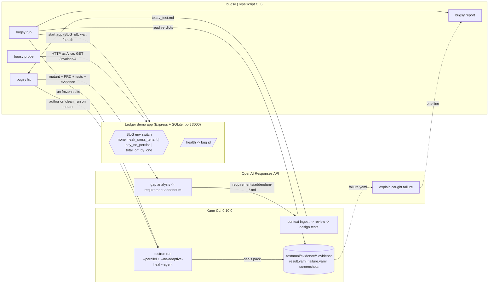

# Bugsy — Final Spec (v1, supersedes BUGSY_PLAN.md)

> **Bugsy checks whether your AI-generated browser tests would notice a realistic bug, then turns each miss into a requirement and a verified Kane test.**

Status: reviewed against the Codex brief (`BUGSY_REVIEW.md`), the installed Kane CLI 0.10.0 skill docs, and the event's own `hack-os` / `hack-gtm` skills and `kanehack` helper (v0.1.28, sha256-verified). §0 is what the hub measures; §1 records what changed and why. Everything after is the build contract.

---

## 0. Event hub compliance — what actually gets measured

Read from the `kanehack` source and the `hack-os` skill. These are rules, not suggestions.

**How a run becomes "source-verified" on the Proof tab.** Every Kane command that should count is run through the wrapper:
```bash
kanehack report --objective "bugsy:<mutant>" -- kane-cli testrun run tests/ --parallel 1 --no-adaptive-heal --bug-detection off --agent
```
`kanehack report` streams Kane's stdout through untouched (our NDJSON parser still works), keeps Kane's exit code, and sends a *redacted* copy of the stream plus `git rev-parse HEAD`. Then the server decides:
- **Exit code decides:** `0` passed, `1` failed, `2` nothing ran, `3` timed out. A run with **no completion event** (`run_end` / `test_md_done` / `testrun_done`) is never a pass.
- **Verified** only if: paired token + own team's project + completion event and exit code agree.
- A failing run opens a **suspected defect**. A teammate **confirms** it. A later **passing run on a different commit** re-verifies the fix. Those are the five Proof counters: runs reported · verified passes · suspected defects · confirmed open · fixes re-verified.
- `kanehack report` warns when the tree is dirty ("run is tied to HEAD, which isn't exactly what ran"). **Commit before the runs that matter.**

**Mapping Bugsy onto those counters** (so the hub sees the story, not just exit codes):

| Bugsy event | Kane exit | Hub counter | Action |
|---|---|---|---|
| Baseline suite on clean app | 0 | verified pass | report it |
| Suite on a mutant, *survived* | 0 | verified pass (!) | report it; the objective text says `bugsy:leak_cross_tenant survived` — this is the talking point: a green verified run on a leaking app |
| Suite on a mutant, *caught* | 1 | suspected defect | report it; a teammate confirms it in the hub ("planted: <mutant>") |
| New test from `fix`, red on mutant | 1 | suspected defect | report, confirm |
| After `fix` commits, suite green on clean at the **new SHA** | 0 | **fix re-verified** | report it — this run exists only so the hub can close the loop; it's a cheap cached replay |
| A *real* bug in Ledger found by the first suite run | 1 | suspected defect → fixed → re-verified | **don't hide it.** Report, fix the app, commit, rerun. This is the cleanest "proof not presence" evidence we can get, and it's honest |

**Setup, once, in your own terminal (not from an agent):** `curl -fsSL https://kaneclihack.sh/install.sh | sh` (read: never sudo, asks before each install; it also installs Codex CLI and the `hack-os` skill into `~/.agents/skills`), then `kanehack pair`, then `kanehack consent yes` (nothing is sent without it). `kanehack status` lists reported runs as `KR-<n>`.

**Evidence packs are never committed to the public repo.** `hack-gtm` non-negotiable #8: packs hold HAR/console logs with cookies, tokens and test passwords; the hub itself refuses to publish `.evidence`, `.zip`, `.har`. The rubric's "evidence pack in the repo" is satisfied by a **redacted export** (`evidence/<exec_id>/`: `run.yaml`, `result.yaml`, `failure.yaml`, step screenshots — no HAR, no console logs) plus the Kane report link in README. Full packs go to the hub: `kanehack report --evidence <pack>` (≤ 4 MB) or the Proof tab upload (matched by sha256). `.gitignore` ignores `.testmuai/` entirely.

**What `submission_preflight` requires to finalize:** project name + type, one-line pitch, repo URL, **exact commit SHA**, live URL *or run command*, at least one **linked** Kane run (reported runs must be ticked on the Submit tab or sent via `team_page_update.kane_run_ids`), harness description, Kane components used (tick boxes), known limitations. Deck and video are not required to finalize but the **shipped prize** needs the three essentials plus any two of video / blog / X / Show HN, each as a live link, saved on the Submit tab by 18:00 before the captain finalizes.

**Wording rules from `hack-gtm`:** "built with OpenAI, tested with Kane CLI"; never "in partnership with OpenAI"; the event is "Kane CLI Hack Day". X: `@testmuai` and `@OpenAI`; LinkedIn: company page *TestMu AI*. Kane CLI has no own account. Every Kane claim must trace to a real run. The person posts everything themselves.

---

## 1. Review verdict on the Codex brief

**Recommendation: build, with the brief's scope cut adopted.** The brief is right on the points that matter: the original plan equated "any failure" with "caught", shared one database across parallel tests, ran clean and mutant with different healing settings, and overclaimed novelty. Those are fixed below. The brief is wrong, or over-cautious, in a few places, also noted.

| Brief point | Verdict | What the spec does |
|---|---|---|
| Any non-zero exit ≠ caught; need an attribution rule | **Accept — blocker.** | §7: verdict comes from Kane's per-test `status` and the failing step, not the exit code. Verified: `testrun_member_end` carries `status ∈ passed\|failed\|broken\|interrupted` and `failure.step_index`. |
| Parallel tests share state and break exact-total assertions | **Accept — blocker.** | §7: `--parallel 1` for all measurement runs; app restarted with fresh seed before every experiment. |
| Clean and mutant must use identical runner settings (healing off on both) | **Accept.** | §10: `--no-adaptive-heal` on *every* measurement run. Healing re-authors a failing step up to 3 times and could author around a mutation. |
| Separate "mutation is active" probe from suite execution | **Accept.** | §9 `bugsy probe`: an HTTP check that shows clean denies / mutant leaks. Not counted as a test. It's also the "Alice sees Bob's invoice" moment in the demo. |
| Cut to 3 mutations; defer OpenAI patches, worktrees, narrative, parallelism | **Accept, with one tweak.** | 3 mutants in the default matrix. Two more stay in the app behind the same env flag (they cost ~15 lines each, not Kane credits) and are opt-in via `--mutants`. OpenAI patches/worktrees are **out**. |
| Don't promise "2/6"; disclose that the PRD omits tenant isolation | **Accept.** | §12: the spec-gap is *the story* ("the PRD never said it, the agent never tested it"), stated out loud. No predicted score in any public text. |
| Drop "no prior art" (Mutta exists for E2E web mutation testing) | **Accept.** | §15: positioning is "first mutation harness for AI-generated Kane suites with a requirement→test repair loop". |
| HN/Lovable figures unverified | **Partly accept.** | The HN numbers came from the HN API this morning; the Lovable figure is from a secondary blog. Public text links the threads and says "reported", never quotes a number as fact. |
| Build-step inconsistency, `cart_total` naming, `git add -A` | **Accept.** | Run with `tsx`, no build. Mutant renamed `total_off_by_one` with one definition. `fix` stages only the files it created. |
| "Keep OpenAI central through gap analysis only; review whether sufficient" | **Not sufficient alone; add one more call site.** | §11: OpenAI (1) does gap analysis → requirement, (2) explains each *caught* failure in one line from `failure.yaml`. Both are substantive; neither decides a verdict. |
| Brief's `Inconclusive`/`Invalid` verdict classes | **Accept, simplified.** | §7 keeps four verdicts; `invalid` is detected by the probe, `inconclusive` by Kane status `broken`/`interrupted` or a failure at step 0 (never reached the app). |

**Risks the brief missed** (all handled in §14): Kane's Test Manager project must be configured before `testrun` (otherwise an auto-default event, or exit 2 in a linked folder); the designed negative test must be *authored on the clean app* so its recording captures "Not found" — authoring it on the mutant would record the leak as expected behaviour; `design tests` can emit more tests than you want (`--max 1`); `--bug-detection` must be `off` so authoring doesn't halt on a "suspected product bug".

---

## 2. What Bugsy is (plain language)

- **Mutation testing** is a 50-year-old idea: deliberately break the program in one small way (a *mutant*), run the tests, and see if any test fails. If none does, the mutant *survived* — your tests wouldn't have noticed that bug. The fraction caught is the *mutation score*.
- It has always been done on unit tests. **Bugsy does it on AI-driven browser tests** (Kane CLI `_test.md` files, executed in a real Chrome).
- The twist for the AI era: when a mutant survives, it's usually because **the requirement was never written down**, so the agent never tested it. Bugsy uses OpenAI to name the missing requirement, then uses Kane's own assurance flow (requirement → use-case → designed test) to generate the test, and proves it: green on the clean app, red on the mutant.

What it is **not**: a security scanner, a proof the app is correct, or a general tool for any app today. It measures the suite's sensitivity to a chosen set of realistic bugs.

---

## 3. Scope

### MVP (must exist by 4:00 pm)
1. **Ledger**: a 4-page invoices app with two seeded users and a mutant switch.
2. **Three mutants** in the default matrix: `leak_cross_tenant`, `pay_no_persist`, `total_off_by_one`.
3. **A Kane suite** of 3–4 tests designed from `requirements/ledger-prd.md` via Kane's assurance commands, authored once on the clean app, recordings committed.
4. **`bugsy run`**: clean baseline + each mutant, sequential, fresh app per experiment, verdicts from Kane evidence, `bugsy.report.json` + `report.html`.
5. **`bugsy probe <mutant>`**: proves the mutant is live (clean denies, mutant leaks).
6. **`bugsy fix <mutant>`**: OpenAI gap analysis → requirement addendum → Kane designs the test → authored on clean (green) → run on mutant (red) → commit.
7. README with one run command; **redacted** evidence exports committed (§0), full packs uploaded to the hub.

### Opt-in if the loop is stable by 2:30
- Mutants 4–5 (`validation_inverted`, `login_any_password`) via `--mutants all`.
- OpenAI one-line explanations of caught failures in the report.
- Coverage panel: Kane's own coverage figure (read-only projects API, §5) beside the catch rate.

### Deferred (not today)
OpenAI-generated source patches, git worktrees, arbitrary-app support, parallel execution, AI narrative, Linear/GitHub issue filing.

---

## 4. Tech stack

| Layer | Choice | Why |
|---|---|---|
| Language/runtime | TypeScript on Node 20, run with `tsx` (no build step) | One toolchain, zero compile loop, agents already know it |
| Demo app | Express 4 + EJS views + `better-sqlite3` (in-memory) + `express-session` | Server-rendered HTML with stable text = crisp Kane assertions; in-memory DB reseeds on every boot, which is the fixture reset |
| CLI | `commander`, `execa` (spawn), `yaml`, `adm-zip` (read `.evidence`), `zod` (schemas) | Small, boring, fast to wire |
| Test runner | **Kane CLI 0.10.0** — `context ingest`, `context review`, `design tests`, `testrun run`, evidence packs | The grader. Verified commands/flags in §10 |
| LLM | **OpenAI Responses API**, `openai` npm, strict JSON-schema outputs, model from `OPENAI_MODEL` | The gate; structured outputs keep it deterministic enough to drive a CLI |
| Report | Self-contained `report.html` (inline CSS, no framework) + `bugsy.report.json` | Opens from disk at the judges' table |
| Repo | GitHub public `aayushkhator1994/bugsy`, npm workspaces `app/` + `bugsy/` | Already created |

Secrets: `OPENAI_API_KEY` from `.env` (gitignored). Kane auth via `kane-cli login --oauth` (stored by Kane, not in repo).

---

## 5. Architecture



### The fix loop, step by step

```mermaid
sequenceDiagram
  participant U as You
  participant B as bugsy fix
  participant O as OpenAI
  participant K as Kane CLI
  participant A as Ledger app
  U->>B: bugsy fix leak_cross_tenant
  B->>O: mutant desc + PRD + existing tests + survived-run evidence
  O-->>B: {missing_requirement, addendum_markdown, test_hint}
  B->>B: write requirements/addendum-leak_cross_tenant.md
  B->>K: context ingest addendum --mode agent
  K-->>B: new use-case id
  B->>K: context review --approve <uc>
  B->>K: design tests --use-case <uc> --mode agent --max 1
  K-->>B: tests/tenant_isolation_test.md
  B->>A: start BUG=none
  B->>K: testrun run tests/tenant_isolation_test.md (authors + records)
  K-->>B: passed (exec id G)
  B->>A: restart BUG=leak_cross_tenant
  B->>K: testrun run tests/tenant_isolation_test.md --no-adaptive-heal (via kanehack report)
  K-->>B: failed at assertion step (exec id R) -> hub: suspected defect
  B->>B: git add addendum + test + recordings; commit "catch leak_cross_tenant — Kane G green / R red"
  B->>A: restart BUG=none
  B->>K: testrun run tests/ (cached replay, via kanehack report, at the new SHA)
  K-->>B: passed (exec id V) -> hub: fix re-verified
  B-->>U: before/after row
```

Every Kane call above goes through `kanehack report` when `KANEHACK=1` (default once paired), so the hub sees G as a verified pass, R as a suspected defect, and V as the re-verification on a new commit.

### Component responsibilities

| Component | File | Does | Does not |
|---|---|---|---|
| App runner | `bugsy/src/app-runner.ts` | Spawns `tsx app/src/server.ts` with `BUG`, `PORT`; polls `/health` until `bug` matches (15 s); kills on exit/error; refuses to start if port busy and reports the PID | Reuse a running app |
| Kane adapter | `bugsy/src/kane.ts` | Spawns `kanehack report --objective <label> -- kane-cli …` (or bare `kane-cli` when `KANEHACK=0`) with `KANE_CLI_USER_AGENT=bugsy`, stdin `/dev/null`; parses NDJSON, ignoring unknown event types including the trailing `kanehack_report` line; returns `{execution_id, members[], summary, pack_path, exit_code, kanehack_run_id?}` | Interpret verdicts |
| Evidence reader | `bugsy/src/evidence.ts` | Opens `.evidence` zip; reads `tests/*/result.yaml`, `steps/*/failure.yaml`; writes the **redacted export** `evidence/<exec_id>/` (run.yaml, result.yaml, failure.yaml, screenshots only) and copies failing-step screenshots to `report-assets/` | Copy HAR or console logs anywhere; modify packs |
| Coverage panel (opt-in) | `bugsy/src/coverage.ts` | `GET https://kaneai-api.lambdatest.com/v16-lattice/v1/projects/{id}/coverage` with `LT_USERNAME`/`LT_ACCESS_KEY` basic auth from env, cached 5 min, shown next to the catch rate: *"Kane coverage 100% · Bugsy catch rate 33%"* — the thesis in one line | Run in the browser; log the key |
| Verdict engine | `bugsy/src/verdict.ts` | Applies §7 rules to produce `caught\|survived\|inconclusive\|invalid` | Call OpenAI |
| Probe | `bugsy/src/probe.ts` | Logs in as Alice over HTTP, GETs Bob's invoice, records status + whether Bob's client name appears | Count as a test |
| OpenAI client | `bugsy/src/openai.ts` | Two schema-bound calls; logs prompt/response to `bugsy/.calls/<ts>-<kind>.json` with key never present | Decide verdicts |
| Fix | `bugsy/src/fix.ts` | The sequence above; stages only files it wrote | `git add -A` |
| Report | `bugsy/src/report.ts` | JSON + HTML; keeps `history[]` of runs with suite hash | Recompute aggregates across different suite versions |

---

## 6. Ledger demo app

**Fixtures (deterministic, reseeded on every boot):**

| User | Password | Invoices (id, client, amount, status) |
|---|---|---|
| alice@ledger.test | alice123 | 1 Acme Co $1,200.00 Unpaid · 2 Globex $350.50 Paid · 3 Initech $89.99 Unpaid |
| bob@ledger.test | bob123 | 4 Umbrella $4,000.00 Unpaid · 5 Hooli $75.00 Unpaid · 6 Vandelay $999.00 Paid |

Alice's **Total outstanding = $1,289.99** (1 + 3). Bob's = $4,075.00.

**Routes and exact visible text** (Kane asserts on these):

| Route | Behaviour | Text |
|---|---|---|
| `GET /login`, `POST /login` | session cookie; bad creds re-render | `Invalid email or password` |
| `GET /invoices` | current user's invoices, table columns `Invoice #`, `Client`, `Amount`, `Status`; footer total | `Total outstanding: $1,289.99` |
| `GET /invoices/:id` | detail; **404 page if not owner** | header `Invoice #3`, `Client: Initech`, `Amount: $89.99`, `Status: Unpaid`; 404 page says `Invoice not found` |
| `POST /invoices/:id/pay` | status → Paid, redirect to detail | banner `Invoice #3 marked as paid`, `Status: Paid` |
| `GET /invoices/new`, `POST /invoices` | form; validation | `Amount must be greater than 0`; success → detail of new invoice |
| `GET /health` | JSON | `{"ok":true,"bug":"<id or none>","seed":"v1"}` |

Footer on every page shows `build: <bug id>` in small grey text so the room can see which mutant is live.

**Mutants** — `app/src/mutants.ts` exports `MUTANTS: {id, title, description, bug_class}[]`; routes call `isBug(id)`. Exactly one behaviour per id:

| id | Exact change | Default matrix |
|---|---|---|
| `leak_cross_tenant` | `GET /invoices/:id` drops `AND owner_id = ?` from the query. Alice at `/invoices/4` sees Umbrella $4,000.00. | yes |
| `pay_no_persist` | `POST /pay` redirects with the success banner (flash) but skips the `UPDATE`. Detail still shows `Status: Unpaid`. | yes |
| `total_off_by_one` | Total loop uses `< rows.length - 1`: Alice's total shows `$1,200.00` instead of `$1,289.99`. | yes |
| `validation_inverted` | `if (amount > 0) error` instead of `<= 0`. | opt-in |
| `login_any_password` | Password compare removed; any password logs in. | opt-in |

---

## 7. Experiment protocol and verdict rules (the proof discipline)

**Freeze the suite.** Before measurement, compute `suite_hash = sha256` over every `tests/*_test.md` plus its `output-*/` recordings. Every experiment record carries it. A `fix` changes the suite → new hash → the matrix must be rerun before any aggregate is reported.

**One experiment = one (mutant, suite_hash) pair:**
1. Start app with `BUG=<id>`; wait for `/health.bug === id`. For `id ≠ none`, run the probe first; if the probe shows no behavioural difference → verdict `invalid`, skip Kane.
2. `kane-cli testrun run tests/ --parallel 1 --no-adaptive-heal --bug-detection off --agent --name "bugsy:<id>:<hash8>" < /dev/null`.
3. Stop the app. Read the pack.

**Verdict rules** (deterministic, from Kane's own fields):

| Verdict | Rule |
|---|---|
| `caught` | ≥1 member `status: failed` **and** that member's `failure.step_index ≥ 1` (it got past the first step, i.e. reached the app) **and** the clean baseline for the same `suite_hash` has that member `passed` |
| `survived` | all members `passed`, and probe confirmed the mutant is active |
| `inconclusive` | any member `broken` or `interrupted`; or a failure at `step_index 0`; or the clean baseline is not all-passed; or the pack is missing |
| `invalid` | probe found no behavioural difference, or app failed `/health` |

**Score:** `catch_rate = caught / (caught + survived)` over conclusive, valid experiments. The report always shows `attempted`, `inconclusive`, `invalid` counts next to it. It is a sensitivity measure against *these* mutants, nothing more.

**Why `step_index ≥ 1`:** a failure at step 0 is almost always "couldn't open the URL", not a caught bug. This is the cheapest attribution rule that survives a hackathon; the report shows the failing step's text and screenshot so a human can check it.

---

## 8. Data contracts

`mutants.json` (generated from the app's registry):
```json
[{"id":"leak_cross_tenant","title":"Cross-tenant invoice access","description":"...","bug_class":"authorization","probe":{"login_as":"alice","get":"/invoices/4","expect_clean":404,"expect_mutant":200,"marker":"Umbrella"}}]
```

Experiment record (one per mutant per run, appended to `bugsy.report.json.history[]`):
```json
{"mutant":"leak_cross_tenant","suite_hash":"3f9a…","app_rev":"a958153","settings":{"parallel":1,"adaptive_heal":false},
 "probe":{"clean_status":404,"mutant_status":200,"marker_found":true},
 "kane":{"execution_id":"…","pack":".testmuai/evidence/….evidence","members":[{"path":"tests/login_test.md","status":"passed"},{"path":"tests/invoice_detail_test.md","status":"passed"}]},
 "verdict":"survived","started_at":"…","duration_s":212}
```

`bugsy.report.json`:
```json
{"suite_hash":"…","baseline":{"execution_id":"…","all_passed":true},
 "matrix":[/* latest experiment per mutant for this suite_hash */],
 "summary":{"attempted":3,"caught":1,"survived":2,"inconclusive":0,"invalid":0,"catch_rate":0.33},
 "history":[/* every experiment ever, any suite_hash */],
 "fixes":[{"mutant":"leak_cross_tenant","addendum":"requirements/addendum-leak_cross_tenant.md","test":"tests/tenant_isolation_test.md","green_exec":"…","red_exec":"…","commit":"…"}]}
```

---

## 9. CLI spec

All commands accept `--app-dir ./app --tests ./tests --port 3000 --json`. Exit 0 on completion even when mutants survive (that's a result, not an error); exit 1 only on Bugsy's own failure.

- **`bugsy run [--mutants default|all|<id,...>]`** — baseline on `none` first (abort with a clear message if not all green), then each mutant per §7. Prints the table below, writes JSON + HTML.
- **`bugsy probe <mutant>`** — starts clean, probes, starts mutant, probes, prints both results and the HTML snippet around the marker. Used standalone in the demo.
- **`bugsy fix <mutant> [--use-prepared]`** — §5 sequence. On a Kane pause (exit 3) answers once with `--message "<test_hint>"`; on a second pause, or after 4 minutes, falls back to `fixtures/prepared/<mutant>_test.md` **and prints `USING PREPARED TEST`** so nobody mistakes it for live generation. Commits `requirements/addendum-*.md`, the new `_test.md`, its `output-*/` recordings, and the two packs. Message: `test: catch <mutant> — Kane <G> green on clean, <R> red on mutant`.
- **`bugsy report`** — regenerates HTML from JSON.

Output of `run`:
```
Bugsy ▸ suite 3f9a…  app a958153  settings parallel=1 heal=off
  baseline  none               passed 4/4   exec 7c1d…
  ✔ caught   total_off_by_one   invoice_list_test step 3 "verify total is $1,289.99"  exec 9e20…
  ✘ survived pay_no_persist     4/4 passed — no test revisits the invoice after paying   exec 1b77…
  ✘ survived leak_cross_tenant  4/4 passed — no test opens another user's invoice       exec 55aa…
catch rate 1/3 (33%) · attempted 3 · inconclusive 0 · invalid 0
next: bugsy fix leak_cross_tenant
```

---

## 10. Kane integration (verified against the installed 0.10.0 skill docs)

| Need | Command / fact | Source |
|---|---|---|
| Design tests from PRD | `kane-cli context ingest requirements/ledger-prd.md --mode agent` → `kane-cli context review --approve <uc…>` → `kane-cli design tests --use-case <uc> --mode agent --max 1` | assurance.md §1, §5 |
| Pause handling | exit `3` = paused, resume with `--resume <sid> --message "…"` | assurance.md §2 |
| Batch run | `kane-cli testrun run tests/ --parallel 1 --no-adaptive-heal --bug-detection off --agent --name <label> < /dev/null` | testrun.md |
| Per-test outcome | `testrun_member_end {path, status: passed\|failed\|broken\|interrupted, failure?: {message, step_index?}, log_path}`; unauthored tests emit `testrun_authored_member_end` | testrun.md events |
| Totals + exec id | `testrun_summary {totals, execution: {id, status}}`, then `testrun_done` | testrun.md |
| Pack location | `.testmuai/evidence/<execution_id>.evidence` (zip) | evidence.md |
| Verdict detail | `tests/<id>/result.yaml` (`steps[]: ordinal, status, kind`), `steps/<n>-<id>/failure.yaml` (`error`, `page_state`, `triage.rca`), `screenshot.png` | debug.md |
| Replay semantics | first run authors + records; later runs replay from `output-<stem>/` (**commit it**); editing step N re-authors N onward | testmd.md replay rule |
| Healing | default: up to 3 shrinking replays then full re-author → **off on all measurement runs** | testmd.md §replay policy |
| Frontmatter | `url: http://localhost:3000`, `headless: true`, `mode: testing`, `max_steps: 25`, `tags: [ledger]` | testmd.md |
| Project setup | `testrun` needs a Test Manager project/folder; `kane-cli config project` / `folder` once at 11:15, or accept the `project_folder_auto_defaulted` event | testmd.md, testrun.md preflight |

Authoring the negative test (`tenant_isolation`) **must** happen with `BUG=none` so the recording captures `Invoice not found`. Bugsy enforces this: `fix` always authors on clean.

**Unverified until the first run (checkpoint C1):** credit cost per authored run and per replay; wall time per test; whether `design tests` from a 40-line PRD yields 3–4 tests or more.

---

## 11. OpenAI integration

Model: `OPENAI_MODEL` from `.env`. At 11:15 run `curl -s https://api.openai.com/v1/models -H "Authorization: Bearer $OPENAI_API_KEY" | jq -r '.data[].id' | grep -i gpt-5 | sort` and pick the newest general model listed. Responses API, `text.format: {type: "json_schema", strict: true}`.

**Call 1 — gap analysis (`fix`).** Input: mutant `{id, title, description, bug_class}`, `ledger-prd.md`, every `tests/*_test.md`, the survived run's member list with each test's step headings. Output schema:
```json
{"missing_requirement":"string (one sentence, user-observable)",
 "why_current_tests_miss_it":"string",
 "addendum_markdown":"string (a requirement paragraph in the PRD's voice; no test steps)",
 "test_hint":"string (one sentence Bugsy can send to Kane if design pauses)"}
```
Rule in the prompt: the requirement must be general ("a user must not view another user's invoice"), never name invoice #4 or the mutant. This addresses the overfitting question: Kane designs the test from the requirement, and the test is first proven on the clean app.

**Call 2 — explain caught failure (`run`, opt-in).** Input: `failure.yaml` of the failing step + the mutant description. Output: `{"explanation":"one line","consistent_with_mutant":true|false}`. Shown in the report; **does not change the verdict**.

Every call is logged to `bugsy/.calls/<ts>-<kind>.json` (`{model, input, output, usage}`). The key is never read by any code path that writes to disk other than the SDK.

---

## 12. Live demo sequence (4:00 table, ≤ 6 min)

Pre-state: app not running; `bugsy.report.json` from the 2:30 matrix on disk; terminal font 18pt; `report.html` open in a tab.

| # | Live or prepared | Action | What the judges see |
|---|---|---|---|
| 1 | prepared | `jq .summary bugsy.report.json` + open `report.html` | The matrix with timestamps, suite hash, exec ids. "This ran at 2:30, here's the pack for each row." |
| 2 | **live** | `bugsy probe leak_cross_tenant` | Clean: `404 Invoice not found`. Mutant: `200`, HTML contains `Umbrella`, `$4,000.00`. "Alice just read Bob's invoice." |
| 3 | **live** | `bugsy run --mutants leak_cross_tenant` | Kane runs 4 tests against the leaking app, all pass. Verdict `survived`. "The suite is green on a leaking app. The PRD never mentioned tenant isolation, so the agent never tested it." |
| 4 | **live** | `bugsy fix leak_cross_tenant` | OpenAI names the missing requirement; Kane designs `tenant_isolation_test.md`; green on clean (exec G); red on mutant at the `Invoice not found` assertion (exec R); commit lands. If it pauses twice: `USING PREPARED TEST` is printed and said aloud. |
| 5 | prepared | `git log --oneline -5` | The commit message with both exec ids. |
| 6 | prepared | `report.html` after `bugsy report` | Row flips to `caught`; history shows both suite versions. Aggregate is marked "rerun pending" until the full matrix runs again — say so. |

Measured at the 3:30 dry run: steps 2–4 must fit in 4 minutes. If step 4 measures > 3 min, run it with `--use-prepared` and show the morning's live-generation log instead.

---

## 13. Implementation order and go/no-go checkpoints

| Time | Checkpoint | Go | No-go fallback |
|---|---|---|---|
| 11:30 **C0** | `kanehack pair` + `consent yes` done, `kanehack status` answers; Kane project configured; OpenAI model chosen; Ledger `/health` + login + list + detail up on clean | — | — |
| 12:15 **C1** | One hand-run `kane-cli testrun run` of one PRD-designed test on clean: passed, pack on disk, `result.yaml` readable. Record credits delta + wall time. | ≤ 4 min and ≤ 2,000 credits per authored test → full plan | > 6 min or > 5,000 credits → 2 mutants, 3 tests, no opt-ins |
| 1:00 **C2** | `bugsy run --mutants leak_cross_tenant`: clean baseline green, probe shows leak, Kane green on mutant → `survived` recorded from the pack, not the exit code | → build `fix` | verdict engine broken → stop features, fix this first; it's the product |
| 2:00 | **Mid-eval**: show C2 output + probe. Ask the judges one question: "is the survived verdict convincing as shown?" | | |
| 2:30 **C3** | `bugsy fix leak_cross_tenant` end-to-end once, live generation. Timed. | ≤ 3 min → live at 4:00 | > 3 min or two pauses → `--use-prepared` at 4:00, say so |
| 3:00 **C4** | Full matrix on the new suite; README; packs committed; `report.html` | | |
| 3:30 | Dry run §12 twice; `kane-cli balance`; **hub housekeeping**: confirm the suspected defects in the Proof tab, upload the key packs (≤ 4 MB each, or Proof tab), tick the runs under "Kane runs for this project", paste pitch / harness description / Kane components / known limitations on the Submit tab | | |
| 4:00 | Scored eval | | |
| 5:00 | Content hour (§16) | | |

Ownership: you run every Kane command that spends credits; agents build against recorded NDJSON/packs from C1 (`fixtures/kane-samples/`) so they don't burn credits iterating.

---

## 14. Risks

| Risk | Likelihood | Handling |
|---|---|---|
| Kane authored run slow/expensive | medium | C1 measures; cut matrix per §13 |
| Design flow yields odd tests (too many, wrong shape) | medium | `--max 1`; review the file before authoring; if unusable, re-design with `--force` once, then hand-write and **say so in README** |
| Negative test authored on the mutant by mistake | low (enforced) | `fix` hard-codes `BUG=none` for authoring and asserts `/health.bug === "none"` first |
| Healing masks a mutant | eliminated | `--no-adaptive-heal` on every measurement run |
| Shared DB state between tests | eliminated | `--parallel 1`, fresh app per experiment; the mark-paid test pays invoice #3, the total test reads Alice's list before any pay in the same run order — and the app is reseeded between experiments anyway |
| Port 3000 held by a crashed app | medium | app-runner refuses to start and prints `lsof -i :3000` PID; `bugsy run --kill-stale` |
| Test Manager project not set → exit 2 | medium | C0 configures it; parse `project_folder_auto_defaulted` |
| `bug-detection` halts authoring | low | `--bug-detection off` everywhere |
| Secrets in packs or call logs | low | `.calls/` writer strips any `sk-` pattern; pre-commit grep in `npm run precommit`; `.env` gitignored |
| Live `fix` stalls | medium | prepared test + announced fallback |
| Overclaiming | medium | §15 wording only |

---

## 15. Claims we can make once the evidence exists

Safe:
- "Bugsy measured that this Kane suite caught N of M planted bugs; here are the packs."
- "The cross-tenant leak survived a green suite; the PRD never specified isolation."
- "OpenAI named the missing requirement; Kane designed the test from it; it passed on the clean app and failed on the mutant (exec ids)."
- "First mutation harness for AI-generated Kane suites, with a requirement→test repair loop."

Not safe: "no prior art" (Mutta, 2023, does E2E web mutation testing), "works on any app", "proves your tests work", any quoted HN point counts or incident numbers without a link and the word "reported".

---

## 16. GTM (5:00–6:00)

Use the event's `$hack-gtm` skill in Codex: it drafts the X thread, LinkedIn post, Show HN title + first comment, blog, deck and a 60–90 s showcase video from one project brief (`~/.agents/skills/hack-gtm/assets/brief-template.md`) and an evidence pack. Fill the brief by 3:00 so 5:00 is paste-and-approve. Its video pipeline (Remotion or ffmpeg, macOS `say` voice) is the sanctioned "motion graphic": it animates the real Kane steps from the pack, never mocks.

Rules it enforces (so don't fight them): tag `@testmuai` and `@OpenAI` on X, company page *TestMu AI* on LinkedIn, hashtag `#KaneCLIHackDay`; "built with OpenAI, tested with Kane CLI"; every Kane claim traces to a run; you post everything yourself; evidence packs never appear in a post. Publish the Ship Page (`kaneclihack.sh/ship/<team>`) in the site's Studio first — the deck URL hangs off it.

Still ours to write: the 2–4 min demo video with *your* voiceover (§12 beats; the rubric wants that length, `hack-gtm`'s 60–90 s showcase is the teaser), blog title *"I planted bugs in an AI-built app to see if its AI-written tests would notice"*, Show HN *"Show HN: Bugsy – mutation testing for AI-generated browser tests (Kane CLI + OpenAI)"*, 3–4 friends for the reach bonus.

---

## 17. Handoff prompts

**Agent A — Ledger app.**
> Build `app/` per `BUGSY_SPEC.md` §6. Express + EJS + better-sqlite3 in-memory + express-session, TypeScript run via `tsx app/src/server.ts`. Fixtures and visible strings exactly as the tables state. Implement all five mutants in `src/mutants.ts` + routes with `// MUTANT: <id>` comments; each id changes exactly one behaviour. `/health` returns `{ok, bug, seed}`. Footer shows `build: <bug>`. Verify every mutant with curl (log in, hit the route, show the diff from clean) and paste the curl transcript into `app/VERIFY.md`. Write no tests.

**Agent B — runner, verdicts, report.**
> Build `bugsy/` commands `run`, `probe`, `report` per `BUGSY_SPEC.md` §0, §5, §7, §8, §9, §10. Read `~/.agents/skills/kane-cli/references/testrun.md`, `evidence.md`, `debug.md`, `testmd.md` first. Spawn Kane through `kanehack report --objective <label> -- kane-cli …` when `KANEHACK=1` (bare `kane-cli` otherwise), stdin `/dev/null`, parse the events named in §10 and ignore unknown types (including the trailing `kanehack_report` line), read verdicts from the pack per §7 — never from the exit code. Write the redacted export (`evidence/<exec_id>/`, no HAR, no console logs) and never copy a `.evidence` file into the repo tree. Build against `fixtures/kane-samples/` (NDJSON + a pack) that the owner records at C1; do not run Kane yourself. Sequential only. `report.html` self-contained.

**Agent C (Codex) — OpenAI + fix.**
> Build `bugsy/src/openai.ts` and `bugsy fix` per `BUGSY_SPEC.md` §5 (sequence diagram), §9, §11. Responses API, strict JSON schema, model from `OPENAI_MODEL`. Drive `kane-cli context ingest` / `context review --approve` / `design tests --mode agent --max 1`; handle exit 3 once with `--message`, then fall back to `fixtures/prepared/<mutant>_test.md` printing `USING PREPARED TEST`. Author on `BUG=none` only (assert `/health`). Stage only the files you created. Log calls to `bugsy/.calls/` with the key never present. Do not run Kane against credits without the owner's go.
