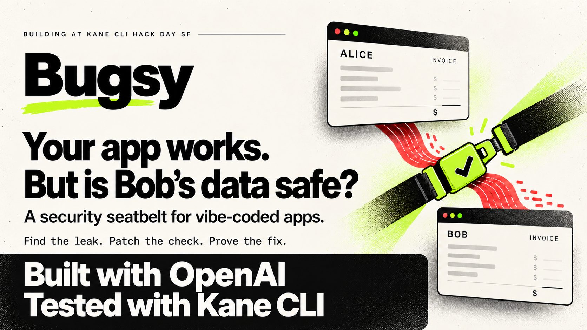
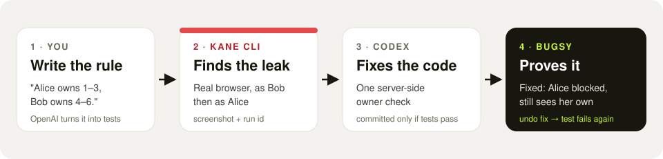
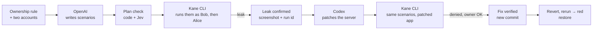
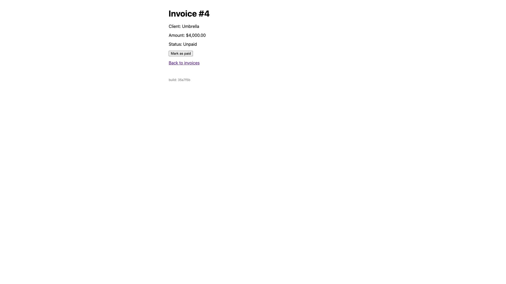

# Bugsy

**A security seatbelt for vibe-coded apps.**

Bugsy checks whether one user can see or change another user's data, fixes it if they can, and proves the fix.



Built with OpenAI, tested with Kane CLI, at Kane CLI Hack Day SF, 24 Oct 2026. `#KaneCLIHackDay`

> [!IMPORTANT]
> **This branch is the app *before* Bugsy, and it has the bugs on purpose.** In the demo app, Alice can open Bob's invoice (S2) and mark it as paid (S5). Run Bugsy (below) and it finds both, fixes them, and writes the proof to `report/`. The earlier build-day run, with all its evidence, is kept on the branch [`archive/run-2026-10-24`](https://github.com/aayushkhator1994/bugsy/tree/archive/run-2026-10-24).

## Why

Coding agents ship apps from short specs. If the spec never says "a user must not see another user's data", the agent never writes the check and never tests it. Everything is green, and Alice can type `/invoices/4` to read Bob's invoice.

## What's different

1. **Rule in, not payloads.** The input is an ownership rule in plain English. Every scenario is a readable requirement before it becomes a test.
2. **Every denial has an owner control.** "Alice is denied" only counts if "Alice can still open her own invoice" passes in the same run. A patch that blocks everyone fails.
3. **It checks itself.** After the fix, Bugsy reverts the patch and reruns. If the scenario doesn't go red, it wasn't testing anything.
4. **A second model checks the plan.** OpenAI writes the scenarios; code rejects a plan that misses a required check, and TypeSafe's Jev independently scores each one.

## How it works



**Built with:** OpenAI Responses API (writes the plan) · Codex CLI (writes the fix) · TypeSafe Jev (checks the plan) · Kane CLI (tests it in a real browser).

Architecture, every tool and who decides what: [docs/architecture.md](docs/architecture.md). Plain-language walkthrough: [docs/how-it-works.md](docs/how-it-works.md). Build contract: [BUGSY_SPEC.md](BUGSY_SPEC.md).

## Run it

**You need:** Node 20+, Chrome, [Kane CLI](https://www.testmuai.com/support/docs/kane-cli-introduction) 0.10.0-rc or newer (`npm install -g @testmuai/kane-cli@rc`), the Codex CLI (`npm i -g @openai/codex`), and an OpenAI API key.

```bash
git clone https://github.com/aayushkhator1994/bugsy.git && cd bugsy
npm install
cp .env.example .env            # add OPENAI_API_KEY and OPENAI_MODEL (TYPESAFE_API_KEY optional)
kane-cli login --oauth
codex login
npm test                        # 64 unit tests, no network
set -a; source .env; set +a
```

Then run the loop. Each step prints what it found; Bugsy commits each fix it makes.

```bash
npx bugsy scan --scenarios-only                        # OpenAI writes the plan; code + Jev check it
npx bugsy --only S2,S5 scan --skip-design              # Kane runs the saved tests: S2 and S5 leak
npx bugsy --only S2 patch S2_other_reads_by_url        # Codex fixes it; Kane re-verifies
npx bugsy --only S5 patch S5_other_marks_paid
npx bugsy self-check S2_other_reads_by_url             # revert, rerun → red, restore
npx bugsy self-check S5_other_marks_paid
open report/report.html                                # leaks, screenshots, fixes, proof
```

Drop `--skip-design` to have Kane design fresh tests from the plan (slower, more Kane credits). `--only` runs just those scenarios plus their owner control. `--no-report` skips sending run summaries to the hack hub.

To look at the app yourself: `npm run app`, open http://localhost:3100, sign in as `alice@ledger.test` / `alice123` or `bob@ledger.test` / `bob123`.

## Findings

**Your run:** everything lands in `report/`: `report/report.html` (open it), `report/bugsy.report.json`, and redacted Kane evidence in `report/evidence/`.

**The build-day run** (archived on [`archive/run-2026-10-24`](https://github.com/aayushkhator1994/bugsy/tree/archive/run-2026-10-24), evidence in its `evidence/` folder):



| Scenario | What a user could do | Found | Fixed and re-verified | Self-check (revert → red) |
|---|---|---|---|---|
| **S2** read by URL | Alice opens Bob's invoice at `/invoices/4` | `2c29d5fa-9e9e-4616-b253-ca2615a9d20e` | `ac202a1e-9bf8-4bc0-8aab-c8458a2f2a59` (fix `16216a9`) | `6173e8eb-e879-4feb-ac28-2654b42991f9` |
| **S5** change by request | Alice marks Bob's invoice as paid with a direct request; Bob sees "Paid" | `c0721a53-4f7d-4817-b342-4d2489eeba7e` | `b632d08b-b124-4232-878d-922ac67482e2` (fix `4eabdca`) | `066b01dc-b470-47fb-9226-8186ace8d587` |
| **S4** signed out, still visible | After sign-out, Back shows Alice's invoice from the browser cache | `1fac2fc6-35b8-4c92-99bb-e95af88fa683` | fix `ab5cc15` (`Cache-Control: no-store`, cookie cleared) | not proven; see limitations |

Final run of all five scenarios on the fixed app: `b50b6a4b-9374-4290-8447-c9fec36bc321`, all passed. Details and credit costs: [docs/e2e-results.md on the archive branch](https://github.com/aayushkhator1994/bugsy/blob/archive/run-2026-10-24/docs/e2e-results.md).

Plan check, two live runs (OpenAI writes the plan, Jev scores it):
```
Plan check ▸ read_by_url S2 ✔ (Jev 0.97) · list S3 ✔ (0.98) · change S5 ✔ (0.97) · signed_out S4 ✔ (0.98)
Plan check ▸ read_by_url S2 ✔ (Jev 0.97) · list S3 ✔ (0.99) · change S5 ✔ (0.98) · signed_out S4 ✔ (0.98)
```

## What's in the repo

| Path | What |
|---|---|
| `app/` | Ledger, styled as the Satrang Sarees customer account area (Express, EJS, SQLite in memory). The demo bugs were seeded on purpose and we say so. |
| `bugsy.config.json` | The only thing a user writes: app URL, two test accounts, the ownership rule, and which checks must be covered. |
| `requirements/ledger-prd.md` | The spec Ledger was built from. It never says who may see what. |
| `requirements/authz-scenarios.md` | Not in the repo until you run Bugsy: `bugsy scan --scenarios-only` writes the plan here. The saved tests were designed from the build-day plan (on the archive branch). |
| `tests/authz/` | Kane `_test.md` files with their replay recordings. |
| `bugsy/` | The CLI (`scan`, `patch`, `self-check`, `report`) and its unit tests. |
| `report/` | Created by a run: the findings page, the report JSON, and redacted Kane evidence (results, failure records, screenshots; no network or console logs). Full sealed packs are on the hack hub, never in this repo. |
| `docs/` | Architecture, how it works, demo script, end-to-end runbook, launch drafts. `docs/archive/` holds superseded plans. |

## Known limitations

- **One app.** Bugsy runs against Ledger today. The runner assumes an app that starts with one command and answers `/health`.
- **Seeded bugs.** S2 and S5 were left in Ledger on purpose for the demo. S4 was not seeded: Kane found it in the default app.
- **S4 is intermittent.** Whether Chrome restores a page from its back/forward cache varies, so the S4 test reproduced 2 of 3 times. The fix is in, but its self-check isn't proven.
- **Some tests were edited or hand-written.** S1–S3 were designed by Kane and not edited. S5 was designed by Kane, then two steps were edited by hand so the direct request carries Alice's session cookie. The S4 test was hand-written in the same format.
- **Only the rules you state.** It isn't a scanner; it checks the ownership rule in the config.
- **Sequential, one browser.** Users switch by signing out and in. Runs take minutes and cost Kane credits.
- **Kane's own diagnosis can disagree.** For S2, Kane's root-cause note blamed test data; Bugsy reads the recorded assertion and the owner control instead (BUGSY_SPEC.md §7).
- **Committed on purpose:** the seeded demo accounts and passwords. Never committed: `.env`, full evidence packs.
- `fixtures/prepared/` holds a hand-written fallback patch and tests. Bugsy prints `USING PREPARED …` whenever it uses them; none of the runs above used them.
