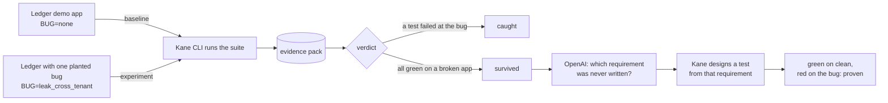

# Bugsy

**Would your AI-written browser tests notice a realistic bug?**

Bugsy plants one realistic bug at a time in an app, runs the app's [Kane CLI](https://www.testmuai.com/support/docs/kane-cli-introduction) test suite against each one, and reports which bugs the suite caught and which it missed. For every miss, an OpenAI model names the requirement nobody wrote down, Kane designs a test from it, and Bugsy proves the test is green on the clean app and red on the bug.

Built with OpenAI, tested with Kane CLI, at Kane CLI Hack Day SF, 24 Oct 2026. `#KaneCLIHackDay`

> Status: building. The design is in [BUGSY_SPEC.md](BUGSY_SPEC.md). Plain-language walkthrough with diagrams: [docs/how-it-works.md](docs/how-it-works.md).

## Why

Coding agents now write the feature *and* the tests, then report "all green". Green means the tests passed. It does not mean they would fail if something broke. Kane's `cover` tells you a test exists for each requirement; nothing tells you whether that test would notice a bug. Bugsy measures that.

## How it works



1. **Baseline.** The suite must pass on the clean app. If it doesn't, Bugsy stops.
2. **Probe.** Before spending a Kane run, an HTTP probe confirms the planted bug is live (clean app returns `404 Invoice not found` for another user's invoice; the mutant returns the invoice).
3. **Experiment.** Kane runs the unchanged suite against the mutant. Verdicts come from Kane's per-test status in the evidence pack, never from the exit code alone.
4. **Fix loop.** For a survivor, OpenAI reads the mutant, the PRD, the tests and the evidence and writes the missing requirement as a PRD addendum. Kane's assurance flow (`context ingest` → `design tests`) turns it into a test. Bugsy authors it on the clean app, runs it on the mutant, and commits only when it's green then red.

## Run it

```bash
cp .env.example .env            # OPENAI_API_KEY, OPENAI_MODEL
kane-cli login --oauth
npm install
npm run demo                    # baseline + 3 mutants, writes bugsy.report.json and report.html
npx bugsy fix leak_cross_tenant # close one gap through OpenAI + Kane
```

## What's in the repo

| Path | What |
|---|---|
| `app/` | Ledger, a 4-page invoices app (Express, EJS, SQLite in memory). Mutants are switched with the `BUG` env var; each changes exactly one behaviour. |
| `requirements/ledger-prd.md` | The PRD the suite was designed from. It says nothing about one user seeing another's invoice. That omission is the point. |
| `tests/` | Kane `_test.md` files designed from the PRD, with their replay recordings. |
| `bugsy/` | The CLI: `run`, `probe`, `fix`, `report`. |
| `evidence/` | Redacted exports of the Kane runs that matter (results, failures, screenshots). Full packs are never committed; they are on the hack hub. |
| `bugsy.report.json`, `report.html` | The latest matrix with every Kane execution id. |

## Score and evidence

Filled in once the runs exist. Every number here links to a Kane execution id.

## Known limitations

- Measures sensitivity to the planted bugs in this catalogue, not the app's overall correctness or security.
- Ledger only, today. The runner assumes an app that takes `BUG` and `PORT` and answers `/health`.
- Sequential runs. Each experiment restarts the app so tests never share state.
- Mutation testing of E2E web suites exists in research (Mutta, 2023). What's new here is doing it on AI-generated Kane suites with a requirement-to-test repair loop.
