# Bugsy

**A security seatbelt for vibe-coded apps.**

Give Bugsy an app, two test accounts and one sentence about who owns what. OpenAI turns the rule into two-account authorization scenarios, each paired with an owner control. Kane CLI runs them in a real browser and reproduces the leak: Alice reads Bob's invoice. Codex patches the ownership check on the server. Kane reruns the same scenarios to prove the fix. Then Bugsy reverts the patch and reruns, to prove the tests would catch the leak again.

Built with OpenAI, tested with Kane CLI, at Kane CLI Hack Day SF, 24 Oct 2026. `#KaneCLIHackDay`

> Status: building. Build contract: [BUGSY_SPEC.md](BUGSY_SPEC.md). Plain-language walkthrough with diagrams: [docs/how-it-works.md](docs/how-it-works.md).

## Why

Coding agents ship apps from short PRDs. If the PRD never says "a user must not see another user's data", the agent never writes the check and never tests it. The app is green and Alice can type `/invoices/4` to read Bob's invoice.

## What's different

1. **Spec-driven.** The input is an ownership rule in plain English, not a list of attack payloads. Every scenario is a readable requirement before it's a test.
2. **Every denial has an owner control.** "Alice is denied" only counts if "Alice can still open her own invoice" also passes. A patch that breaks the app fails.
3. **It checks itself.** After the fix, Bugsy reverts the patch and reruns. If the scenario doesn't go red, it wasn't testing anything.

## How it works

```mermaid
flowchart LR
  R["Ownership rule<br/>+ two accounts"] --> O["OpenAI<br/>scenarios with controls"]
  O --> K1["Kane CLI<br/>runs them as Bob, then Alice"]
  K1 -->|"Alice sees Bob's invoice"| F["Leak confirmed<br/>(screenshot, run id)"]
  F --> C["Codex<br/>patches the server check"]
  C --> K2["Kane CLI<br/>same scenarios, patched app"]
  K2 -->|"denied, owner still OK"| V["Fix verified<br/>(new commit, run id)"]
  V --> S["Revert patch, rerun<br/>→ red again"]
  S --> P["Tests proven,<br/>patch restored"]
```



## Run it

```bash
cp .env.example .env              # OPENAI_API_KEY, OPENAI_MODEL
kane-cli login --oauth
codex login                       # patcher; or use --patcher api
npm install
npx bugsy scan                    # scenarios → Kane tests → run → findings
npx bugsy patch S2_other_reads_by_url
npx bugsy self-check
```

## What's in the repo

| Path | What |
|---|---|
| `app/` | Ledger, a 4-page invoices app (Express, EJS, SQLite in memory). The first commit ships without the ownership check on invoice detail. That is the seeded bug, and we say so. |
| `requirements/ledger-prd.md` | The PRD Ledger was built from. It never mentions tenant isolation. |
| `requirements/authz-scenarios.md` | Generated by OpenAI from `bugsy.config.json`'s ownership rule. |
| `tests/authz/` | Kane `_test.md` files designed from those scenarios, with recordings. |
| `bugsy/` | The CLI: `scan`, `patch`, `self-check`, `report`. |
| `evidence/` | Redacted exports of the Kane runs (results, failures, screenshots). Full packs are on the hack hub, never here. |
| `bugsy.report.json`, `report.html` | Findings with patch diff and before/after Kane run ids. |

## Findings and evidence

Filled in from real runs. Every line links a Kane execution id.

## Known limitations

- Ledger only, today; one read-leak scenario end to end, list isolation, and (opt-in) one write scenario.
- Sequential runs, one browser, sign-out/sign-in between accounts.
- Not a scanner: it checks the rule you state, not every route for every bug.
- The demo accounts and passwords are seeded test data and are committed on purpose.
