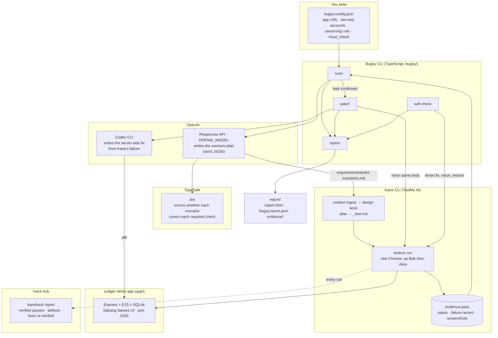
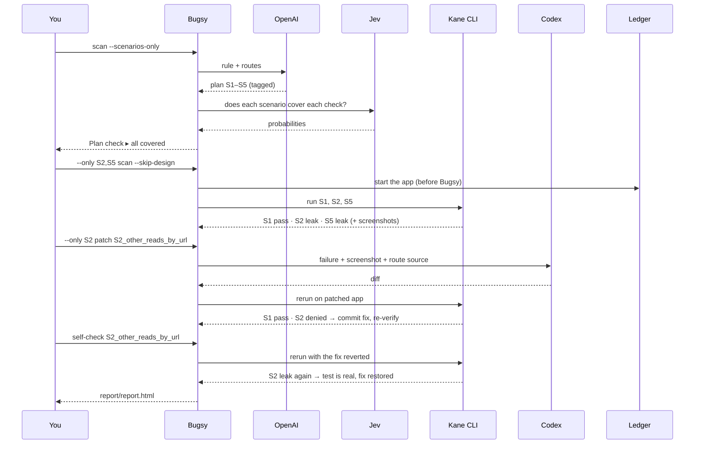

# Architecture

What Bugsy is made of, what each piece does, and what every tool is used for.

## The whole system

## What each tool does

| Tool | Used for | Where in the code | Needs |
|---|---|---|---|
| **OpenAI Responses API** | Turns the one-sentence ownership rule into the scenario plan (S1–S5): steps, exact expected text, which checks each scenario covers, and its owner control. Strict JSON schema, so the output is machine-checked. | `bugsy/src/openai/scenarios.ts`, `schema.ts`, `prompts.ts` | `OPENAI_API_KEY`, `OPENAI_MODEL` |
| **Codex CLI** | Writes the fix. Bugsy hands it Kane's failure record, the screenshot and the route source; Codex returns a unified diff. Runs read-only; Bugsy applies the diff only if the rerun passes. | `bugsy/src/openai/patch.ts` | `codex login` |
| **TypeSafe Jev** | Independently checks OpenAI's plan. One yes/no question per required check per scenario ("Does this scenario test that a signed-in user cannot change another user's invoice?"). Jev answers with a probability; **code decides** (verified at ≥ 0.8). Advisory: if Jev is down or the key is missing, Bugsy says so and never counts it as a pass. | `bugsy/src/verify/jev.ts` (all question wording and thresholds in one place) | `TYPESAFE_API_KEY` (optional) |
| **Kane CLI** | Designs tests from the plan (`context ingest`, `design tests`), runs them in a real Chrome (`testrun run`, healing off so it can't paper over a leak), and seals an evidence pack per run. Bugsy reads its verdicts from the pack, not the exit code. | `bugsy/src/kane.ts`, `evidence.ts` | `kane-cli login` (0.10.0-rc+) |
| **kanehack** | Wraps every Kane run so the hack hub's Proof tab counts it (verified pass, suspected defect, fix re-verified). | `bugsy/src/kane.ts` (`--no-report` skips it) | `kanehack pair`, consent |
| **Git** | The fixture. The app before Bugsy is a commit; each fix is a commit; self-check reverts the fix in the working tree and always restores it. | `bugsy/src/git.ts`, `selfcheck.ts` | — |

## Who decides what

Bugsy never lets a model make the final call. Models give judgments; code decides.

| Decision | Made by | From |
|---|---|---|
| Is the plan complete? | **Code** | OpenAI's tags (`checks`) must cover every `must_check` kind. Jev's scores are shown alongside. |
| Is there a leak? | **Code** (`bugsy/src/verdict.ts`) | Kane's per-test status and failing step. A leak only counts if the owner control passed in the same run and the failure is at the denial step. Timeouts, broken runs and sign-in failures are *inconclusive*, never "secure". |
| May the fix be committed? | **Code** | The same tests rerun on the patched app: every in-scope leak check denied **and** the owner control passing. A "block everyone" fix fails. |
| Is the test real? | **Code** (`self-check`) | With the fix reverted, the leak test must fail again. |

## One run, step by step

## Tech stack

| Layer | Choice |
|---|---|
| Language | TypeScript on Node 20+, run with `tsx` (no build step) |
| Demo app | Express 4, EJS views, better-sqlite3 (in memory, reseeded on start), express-session |
| CLI | commander, execa, zod, yaml, adm-zip, fast-glob |
| Models | OpenAI Responses API (`openai` SDK), Codex CLI, TypeSafe Jev (`@typesafe-ai/sdk`) |
| Browser testing | Kane CLI 0.10.0-rc (TestMu AI), Chrome |
| Tests | `node:test`, 64 unit tests, no network (`npm test`) |
| Output | `report/report.html` (self-contained, no scripts or CDN), `report/bugsy.report.json`, `report/evidence/` (redacted: no network or console logs) |

## Secrets

`.env` holds `OPENAI_API_KEY`, `OPENAI_MODEL` and `TYPESAFE_API_KEY`; it is gitignored. Kane and Codex use their own logins. Call logs in `bugsy/.calls/` are redacted (keys, bearer tokens, account passwords) and not committed. Full Kane evidence packs contain network logs and stay out of the repo.
