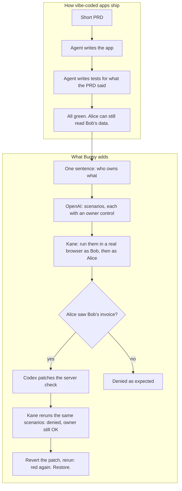
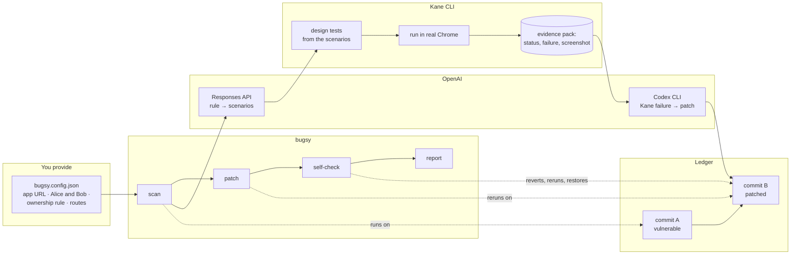
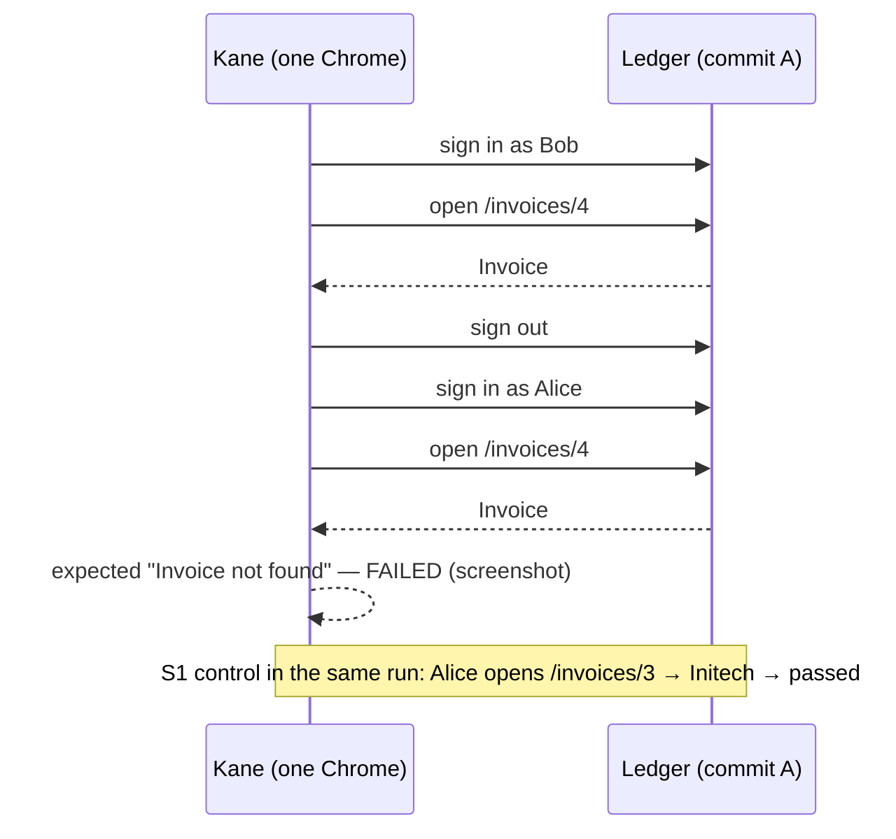
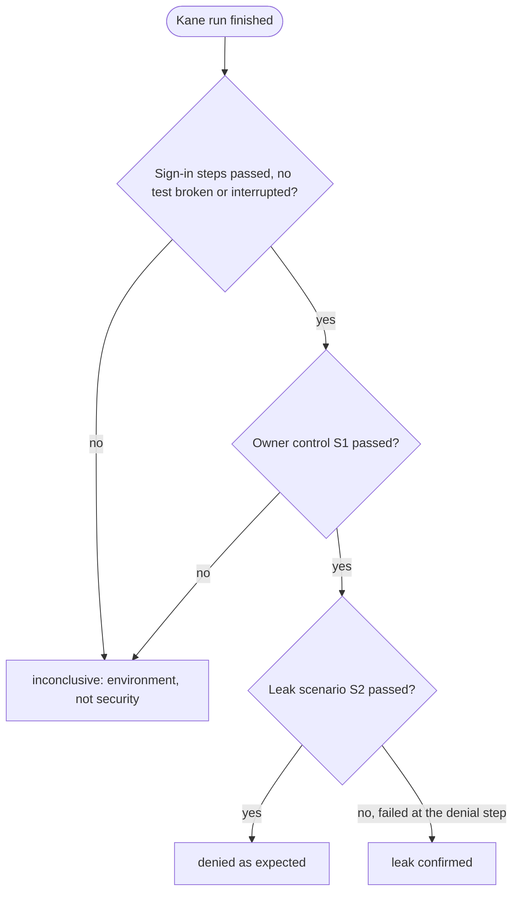
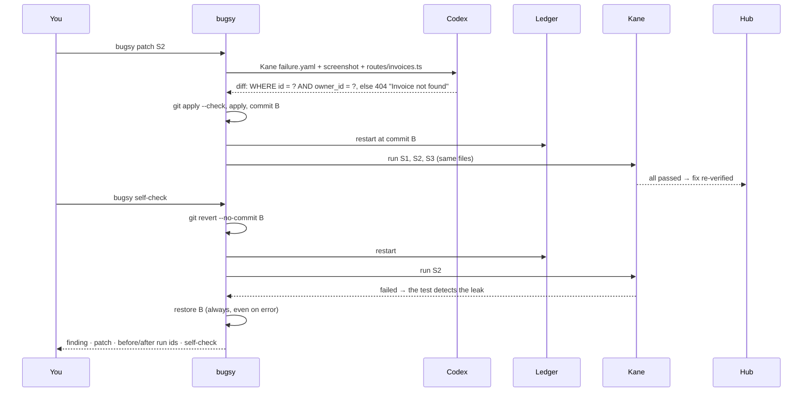

# How Bugsy works, in plain language

Meet **Alice**. She's a freelancer who invoices clients with Ledger. **Bob** uses Ledger too. Ledger was built in an afternoon by a coding agent from a short PRD. Nobody wrote "a user must not see another user's invoices", so nobody tested it. Alice can type `/invoices/4` and read Bob's $4,000 invoice.

Bugsy finds that, fixes it, proves the fix, and proves the proof.

## 1. The idea

## 2. The pieces

**OpenAI** does two jobs: it writes the scenarios from your one-sentence rule (so you can read what will be tested before anything runs), and, as Codex, it writes the server-side patch from what Kane saw.

**Kane CLI** turns each scenario into a browser test, runs it, and seals an evidence pack with a status per scenario, a failure record and a screenshot. Kane is also the eyes of the patching agent: Codex fixes from Kane's failure, not from an HTTP response.

**Ledger** is the app under test. Commit A is the vulnerable one the agent shipped. Commit B is the patched one. Git is the fixture; there's no hidden switch.

## 3. One scenario, start to finish

Why the control matters: if Alice were denied *everything*, including her own invoice, the app would be broken, not secure. A denial only counts when the owner still gets in.

## 4. How a verdict is decided

## 5. The patch, and the proof of the proof

## 6. Why the PRD doesn't mention tenant isolation

`requirements/ledger-prd.md` describes sign-in, the list, the detail page, mark-as-paid and create. It never says who may see what. That's deliberate and we say it at the table: it's the most common way vibe-coded apps leak data. The seatbelt exists because the spec was silent.

## 7. The afternoon

```mermaid
gantt
  title Pacific time
  dateFormat HH:mm
  axisFormat %H:%M
  section Gates
  Mid-eval               :milestone, 14:00, 0m
  Scored eval at table   :crit, 16:00, 60m
  Submissions lock       :milestone, 18:00, 0m
  section Build
  C0 pair, model, codex login, Ledger at A :13:10, 20m
  Ledger app                       :13:10, 50m
  C1 S1 and S2 authored on A       :14:00, 15m
  bugsy scan + verdicts            :13:30, 75m
  C2 scan end to end               :milestone, 14:45, 0m
  bugsy patch + self-check         :14:15, 60m
  C3 patch + self-check timed      :milestone, 15:15, 0m
  README, exports, hub, Submit tab :15:15, 25m
  Dry run x2                       :15:40, 20m
  section Launch
  Video, posts, blog, deck         :17:00, 60m
```

## 8. What the judges' Proof tab will show

| Step | Commit | Kane exit | Hub counter |
|---|---|---|---|
| S1 control passes on the vulnerable app | A | 0 | verified pass |
| S2 leak confirmed | A | 1 | suspected defect, confirmed by us |
| Same scenarios after the Codex patch | B | 0 | fix re-verified |
| Self-check with the patch reverted | B (temp) | 1 | labelled self-check |
