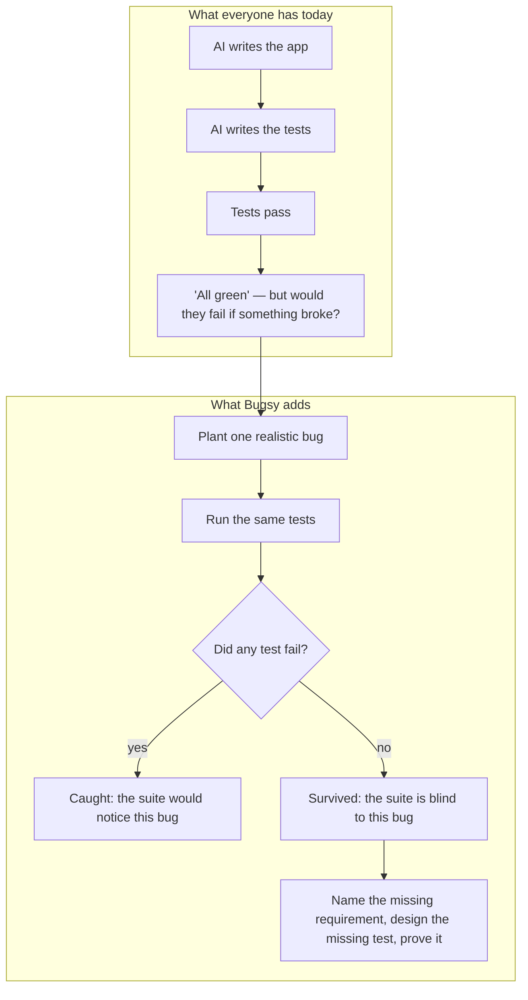
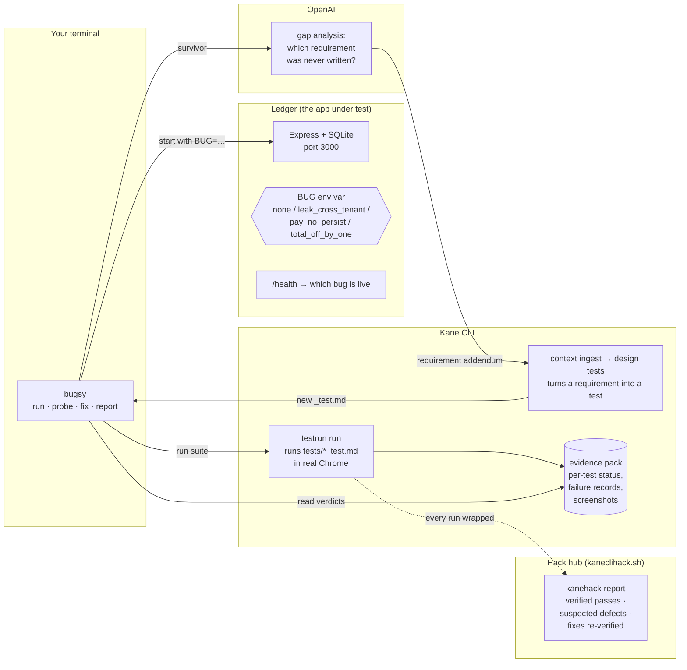
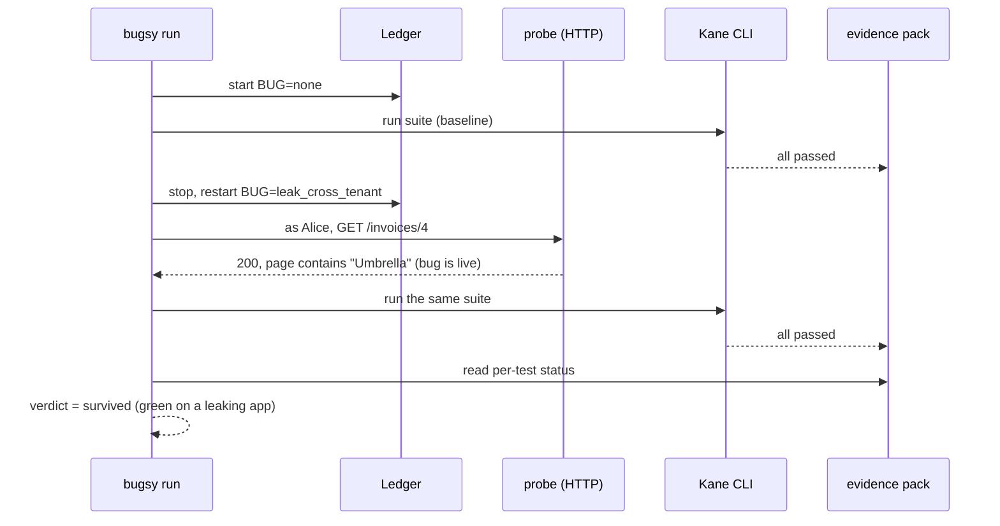
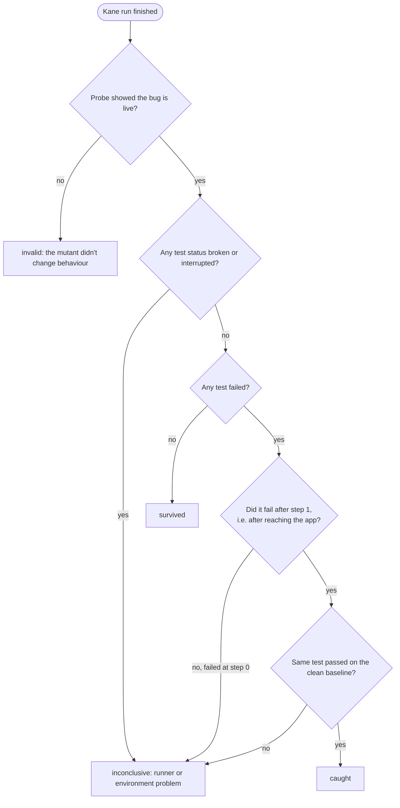
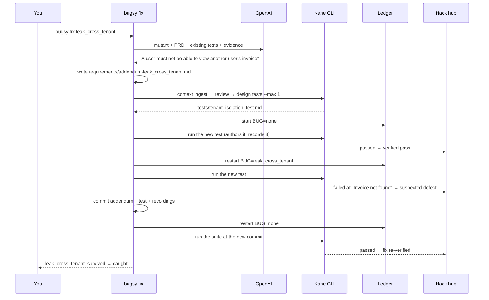

# How Bugsy works, in plain language

Read this before the spec. Every diagram here renders on GitHub.

## 1. The idea in one picture

Mutation testing is simple: break the program on purpose in one small way, run the tests, see if anything fails. If nothing fails, the tests would not have noticed that bug.

## 2. The pieces

**Ledger** is a deliberately tiny invoices app with two users, Alice and Bob. It exists so the bugs are realistic and the assertions are exact (Alice's total outstanding is `$1,289.99`, Bob's invoice #4 is `Umbrella $4,000.00`).

**Kane CLI** is the test runner and the grader. It drives a real Chrome from plain-English test files, and seals an evidence pack per run with the status of every test and step.

**OpenAI** is used for judgement, not for verdicts: it reads the survived bug and the PRD and names the requirement that was never written down. Kane turns that into a test.

**The hack hub** sees every Kane run through `kanehack report`, which is how the judges' Proof tab counts verified passes, suspected defects and re-verified fixes.

## 3. One experiment, start to finish

The probe matters: it proves the bug is really there before Kane runs. Without it, "all passed" could mean "the switch didn't work".

## 4. How a verdict is decided

**Catch rate = caught ÷ (caught + survived)**, counted over valid, conclusive experiments only. The report always shows the inconclusive and invalid counts next to it. It is a measure of how sensitive this suite is to these bugs, nothing more.

## 5. The fix loop

Two rules keep this honest:
- The new test is **always authored on the clean app**. If it were authored on the mutant, Kane would record the leak as normal behaviour.
- The requirement OpenAI writes must be general ("another user's invoice"), never "invoice #4". Kane designs the test from the requirement, so the test checks the rule, not the one seeded row.

## 6. Why the PRD doesn't mention tenant isolation

`requirements/ledger-prd.md` describes sign-in, the list, the detail page, mark-as-paid and create. It never says "a user must not see another user's invoices". That is deliberate and we say so out loud: it's the most common way AI-built apps ship a data leak. The spec never stated it, so the agent never tested it, so the suite is green while Alice reads Bob's invoice. Bugsy's job is to find that gap and close it.

## 7. The day

```mermaid
gantt
  title Hack Day, Pacific time
  dateFormat HH:mm
  axisFormat %H:%M
  section Gates
  Idea locked            :milestone, 12:00, 0m
  Mid-eval (feedback)    :milestone, 14:00, 0m
  Scored eval at table   :crit, 16:00, 60m
  Submissions lock       :milestone, 18:00, 0m
  section Build
  C0 setup, pair, model, app up   :11:00, 30m
  C1 first real Kane run, measure :11:30, 45m
  Ledger app + mutants            :11:15, 105m
  bugsy run + verdicts + report   :11:30, 150m
  C2 first survived verdict       :milestone, 13:00, 0m
  bugsy fix                       :13:00, 90m
  C3 fix loop end to end          :milestone, 14:30, 0m
  Full matrix, README, exports    :14:30, 60m
  Dry run ×2, hub housekeeping    :15:30, 30m
  section Launch
  Video, posts, blog, deck        :17:00, 60m
```

## 8. What the judges' Proof tab will show

| Bugsy event | Kane exit | Hub counter |
|---|---|---|
| Baseline on clean app | 0 | verified pass |
| Mutant survived | 0 | verified pass, on a leaking app (we say this in the demo) |
| Mutant caught | 1 | suspected defect, confirmed by us as "planted" |
| New test red on mutant | 1 | suspected defect |
| Suite green at the new commit after `fix` | 0 | fix re-verified |
| A real Ledger bug found by the first run | 1 → 0 | suspected defect → re-verified. Reported, not hidden. |
